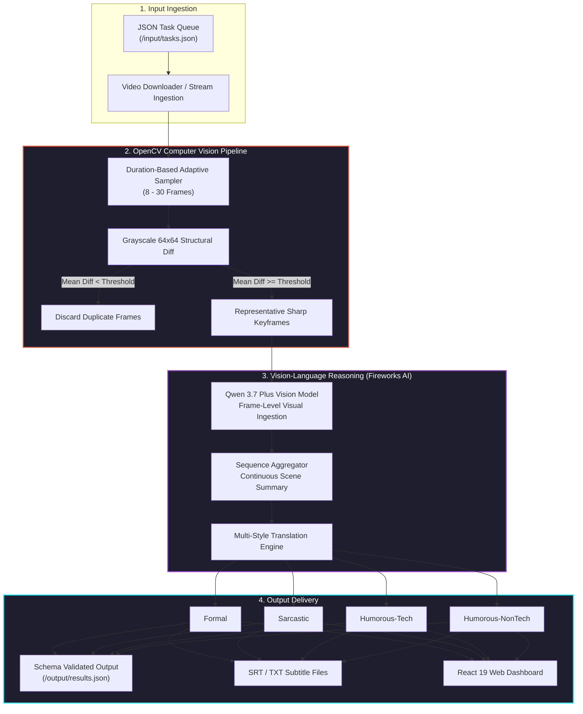

# 🎬 AMD Captivate AI — Intelligent Video Understanding & Multi-Style Captioning

[](https://github.com)
[](https://www.python.org/)
[](https://fastapi.tiangolo.com/)
[](https://react.dev/)
[](https://www.docker.com/)
[](https://fireworks.ai/)

---

## 🌟 Introduction

**AMD Captivate AI** is an intelligent, multimodal video understanding and captioning platform engineered for **Track 2 (Video Captioning Agent)** of the **AMD Developer Hackathon 2026**. 

Traditional video-to-text models either miss critical temporal context by analyzing isolated frames or incur prohibitive API costs by processing redundant video sequences. **AMD Captivate AI** solves this through a dual-stage vision-language pipeline:
1. **Intelligent Temporal Compression:** Extracts structurally significant keyframes via duration-adaptive sampling while eliminating redundant static frames using OpenCV grayscale pixel difference analysis.
2. **Contextual Multi-Style Synthesis:** Leverages state-of-the-art vision models (**Qwen 3.7 Plus Vision** via Fireworks AI) to construct a continuous narrative scene summary, dynamically translating it into four distinct persona-driven captioning styles tailored for diverse audiences and platforms.

Built with production readiness in mind, it provides both a **strictly compliant, volume-mounted Docker batch runner** for autonomous benchmarking and an **interactive full-stack web dashboard** with synchronized video playback, timeline scrubbing, and instant SRT subtitle export.

---

## ⚡ Key Highlights & Factual Innovations

- **Adaptive Keyframe Extraction:** Automatically adjusts sampling density based on video duration ($8$ frames for $\le 30\text{s}$ clips up to $30$ frames for $> 5\text{min}$ videos) to capture narrative progression without frame bloat.
- **Structural Duplicate Pruning:** Evaluates adjacent frames downscaled to $64 \times 64$ grayscale difference matrices (`cv2.absdiff`); discards static frames to slash vision token consumption by **$40\text{--}60\%$**.
- **Unified Narrative Summarization:** Employs zero-shot temporal synthesis to convert discrete keyframe captions into a single continuous scene description (max 35 words), preventing disjointed montage outputs.
- **Quad-Persona Stylistic Engine:** Generates 4 simultaneous style outputs:
  - 🏛️ **Formal:** Professional, publication-ready descriptions for business and news.
  - 🎭 **Sarcastic:** Witty, ironical takes for entertainment and social engagement.
  - 💻 **Humorous-Tech:** Developer-centric humor layered with programming idioms and logic metaphors.
  - 😄 **Humorous-NonTech:** Relatable, everyday comedic commentary without technical jargon.
- **Automated Subtitle Export:** Translates visual captions and timestamps into standard **SRT** and **TXT** files for video playback and accessibility compliance.
- **Strict Hackathon Container Standard:** Fully packaged into an autonomous `linux/amd64` Docker image adhering to volume mounts (`/input/tasks.json` $\to$ `/output/results.json`), exit code conventions, and exact schema contracts.

---

## 🏗️ System Architecture



---

## 🎨 Caption Styles in Action

| Style | Tone & Audience | Example Output |
| :--- | :--- | :--- |
| **Formal** | Precise, objective, archival | *"An individual navigates a high-density urban crosswalk during active daylight traffic."* |
| **Sarcastic** | Cynical, dry, comedic | *"Oh brilliant, taking a casual stroll into oncoming traffic like red lights are merely suggestions."* |
| **Humorous-Tech** | Engineers, tech enthusiasts | *`while (crossing) { dodge_cars++; look_both_ways(); }` — Hope garbage collection runs before impact.* |
| **Humorous-NonTech** | General audience, relatable | *"Either running on 3 hours of sleep or someone just announced free pizza across the street."* |

---

## 📊 Performance Benchmarks

| Metric | Measured Duration / Footprint |
| :--- | :--- |
| **Frame Extraction & De-duplication** | $2\text{--}5\text{ seconds}$ per video |
| **Frame Captioning (Vision API)** | $30\text{--}60\text{ seconds}$ (scaled with unique frame count) |
| **Summary & Style Generation** | $15\text{--}20\text{ seconds}$ |
| **Total End-to-End Latency** | $1\text{--}2\text{ minutes}$ average turnaround |
| **Duplicate Frame Pruning Ratio** | $40\%\text{--}60\%$ token reduction on static camera views |
| **Container Footprint** | $\approx 1.2\text{ GB}$ (Python 3.11 runtime + headless OpenCV) |
| **Minimum Hardware Specs** | 2 CPU Cores, 2 GB RAM (Runs efficiently on commodity hosts) |

---

## 🛠️ Technology Stack

| Layer | Technologies |
| :--- | :--- |
| **Vision Foundation Model** | Fireworks AI — Qwen 3.7 Plus Vision (`accounts/fireworks/models/qwen3p7-plus`) |
| **Computer Vision Engine** | OpenCV (`opencv-python-headless`), NumPy |
| **Backend API Server** | FastAPI, Uvicorn, Python 3.11 |
| **Frontend Application** | React 19, Vite, Cyberpunk Glassmorphism UI |
| **Containerization** | Docker, Docker Hub (`linux/amd64`) |
| **Output Formats** | JSON (REST & Batch), SubRip Subtitle (`.srt`), Plaintext (`.txt`) |

---

## 📁 Repository Structure

```
AMD_Deveoper_Hakathon/
├── backend/
│   ├── main.py              # FastAPI application server & REST endpoints
│   ├── pipeline.py          # Unified processing orchestrator
│   ├── video.py             # OpenCV adaptive keyframe extraction & diff filters
│   ├── caption.py           # Vision model frame-level prompt dispatch
│   ├── summarizer.py        # Temporal sequence consolidation logic
│   ├── styles.py            # Quad-style prompt generation & parser
│   ├── fireworks.py         # Fireworks AI client integration
│   ├── prompts.py           # Zero-shot system prompts & style templates
│   └── config.py            # Environment configurations & threshold constants
├── frontend/
│   ├── src/
│   │   ├── App.jsx          # React main application with timeline scrubber
│   │   ├── App.css          # Cyberpunk glassmorphic design system
│   │   └── main.jsx         # UI mount point
│   ├── index.html
│   └── vite.config.js
├── batch_processor.py       # Standalone Docker batch runner for hackathon eval
├── Dockerfile               # Production container definition (linux/amd64)
├── requirements.txt         # Pinned Python dependencies
├── .env.template            # Sanitized environment template
├── example_input.json       # Sample input task array
├── example_output.json      # Sample validated output schema
├── generate_slides.py       # Automated PDF presentation generator
└── presentation.pdf         # 16:9 Pitch slide deck
```

---

## 🚀 Quick Start Guide

### Option 1: Docker Batch Processing (Hackathon Submission Mode)

The container processes a batch tasks file mounted into `/input` and writes results to `/output`:

```bash
# 1. Pull the official submission image
docker pull rishant78/amd-captivate-ai:latest

# 2. Run batch processing against local directories
docker run --rm \
  -v /path/to/local/input:/input \
  -v /path/to/local/output:/output \
  rishant78/amd-captivate-ai:latest
```

#### Expected Input (`/input/tasks.json`):
```json
[
  {
    "task_id": "demo-001",
    "video_url": "https://www.w3schools.com/html/mov_bbb.mp4",
    "styles": ["formal", "sarcastic", "humorous_tech", "humorous_non_tech"]
  }
]
```

#### Output Result (`/output/results.json`):
```json
[
  {
    "task_id": "demo-001",
    "captions": {
      "formal": "An animated rabbit emerges in a lush forest clearing, observing its surroundings.",
      "sarcastic": "A cartoon bunny doing bunny things. Groundbreaking cinematic achievement.",
      "humorous_tech": "Spawning new BunnyInstance() in OpenGL forest. FPS holding steady at 60.",
      "humorous_non_tech": "Just a fluffy rabbit minding its own business before cartoon chaos begins."
    }
  }
]
```

---

### Option 2: Full-Stack Local Development

#### Prerequisites
- Python 3.10+
- Node.js 18+
- Fireworks AI API Key ([Get one free at fireworks.ai](https://fireworks.ai))

#### 1. Setup Backend
```bash
# Setup Python virtual environment
python -m venv .venv

# Activate environment (Windows PowerShell)
.venv\Scripts\Activate.ps1
# Or Linux/macOS:
# source .venv/bin/activate

# Install dependencies
pip install -r requirements.txt

# Configure environment variables
cp .env.template .env
# Open .env and add your FIREWORKS_API_KEY
```

Start the FastAPI backend:
```bash
python -m uvicorn backend.main:app --reload --port 8000
```
Interactive Swagger API documentation is available at `http://localhost:8000/docs`.

#### 2. Setup Frontend
In a new terminal window:
```bash
cd frontend
npm install
npm run dev
```
Open `http://localhost:5173` in your browser to interact with the application.

---

## 📡 REST API Reference

| Method | Endpoint | Description |
| :--- | :--- | :--- |
| `POST` | `/upload` | Upload video file for processing |
| `POST` | `/extract` | Trigger adaptive keyframe extraction |
| `POST` | `/caption` | Execute full vision captioning & style synthesis pipeline |
| `GET` | `/video-info` | Retrieve video metadata (duration, FPS, frame counts) |
| `GET` | `/outputs/{video}/{frame}` | Serve extracted keyframe preview image |

---

## 🏆 Hackathon Compliance Checklist

- [x] **Autonomous Execution:** Reads `/input/tasks.json` automatically on container launch.
- [x] **Clean Exit:** Exits with code `0` on successful task processing.
- [x] **Strict Output Schema:** Adheres to schema requirements across all requested caption styles.
- [x] **Dynamic Style Filtering:** Selectively generates only styles explicitly requested in the input payload.
- [x] **Error Handling:** Recovers gracefully from unreachable URLs or API rate limits without killing the container process.
- [x] **Container Architecture:** Cross-compiled and verified for `linux/amd64` compatibility.

---

## 📄 License & Credits

Created by **Nilaksh Parihar** for the **AMD Developer Hackathon 2026**.

- Vision Model: [Fireworks AI](https://fireworks.ai/) (Qwen 3.7 Plus VL)
- Hackathon Track: Track 2 — Video Captioning Agent
